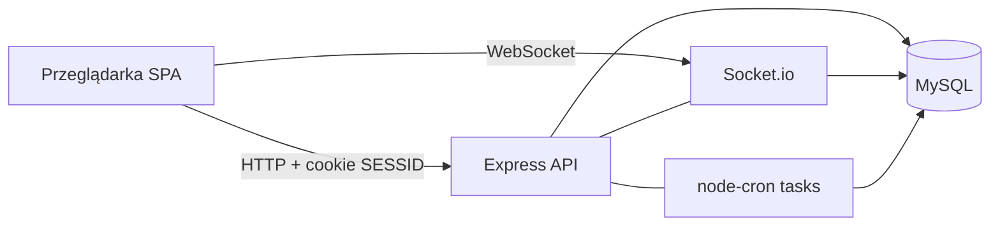

# Architektura — Home Budget Manager

## Cel dokumentu

Utrwala **stan obecny** (as-is) architektury systemu oraz **kierunek lekkiego refaktoru** pod czytelność i utrzymanie. Nie jest planem wdrożenia ani kontraktem I/O (to osobne dokumenty w zestawie).

Powiązanie produktowe: rdzeń budżetu vs otoczka operacyjna — jak w [dokumentacja_koncepcyjna.md](./dokumentacja_koncepcyjna.md).

## Widok systemu (as-is)

System to **dwa deployable’e** plus zewnętrzna baza:

| Element | Rola |
|---------|------|
| **Frontend** (React + Vite, SPA; katalog procesu `frontend/`) | UI, routing, stan klienta, klient HTTP i Socket.io |
| **Backend** (Express, katalog procesu `backend/`) | HTTP API, Socket.io, cron w tym samym procesie, upload/OCR |
| **MySQL** | Magazyn stanu (poza `docker-compose` aplikacji; host DB w sieci zewnętrznej); dostęp przez **Prisma ORM** (norma docelowa) |



Compose buduje kontenery frontendu i backendu; obie usługi wchodzą w zewnętrzną sieć (`main_network`). Frontend serwowany przez NGINX w obrazie; backend nasłuchuje na porcie API.

## Styl architektury

### Styl globalny

**Modularny monolit warstwowy** w jednym procesie API oraz osobna SPA:

- Backend podzielony na **obszary** (auth, household, transactions, …), nie na mikroserwisy.
- Wewnątrz obszaru obowiązuje ten sam pipeline warstw.
- Frontend jest klientem SPA; nie ma BFF ani osobnego warstwy API-gateway w v1.

### Dziedziczenie stylu

**Wszystkie** obszary biznesowe i otoczka stosują **ten sam styl warstwowy**. Nie wprowadzamy osobnych stylów domenowych (np. bogaty model DDD w jednym module, a anemiczny w drugim) w ramach dokumentowanej normy v1.

### Wyjątki techniczne (nie wyjątki stylu domenowego)

| Mechanizm | Traktowanie |
|-----------|-------------|
| Socket.io | Adapter realtime w procesie API |
| `node-cron` (`tasks/`) | Adapter zadań cyklicznych w procesie API |
| Multer + Tesseract (OCR) | Adaptery I/O na brzegu HTTP |

Otoczka produktowa (landing, recenzje, galeria, panel `superadmin`) ma **ten sam styl warstw**, inną **rolę produktową** (operacyjna / prezentacyjna), nie inny wzorzec architektury.

### Poza zakresem styli (v1)

Świadomie nie przyjmujemy jako celu architektury v1:

- mikroserwisów,
- pełnego hexagonal / ports & adapters „na sztywno”,
- CQRS / event sourcingu,
- BFF,
- monorepo ze współdzielonym pakietem kontraktów front↔back.

## Warstwy backendu (norma docelowa)

```text
HTTP / WS / cron
        ↓
   routes (+ middlewares: JWT, role)
        ↓
   controllers   ← cienkie mapowanie req/res
        ↓
   services      ← reguły aplikacji / orkiestracja
        ↓
   database/     ← dostęp do danych wyłącznie przez Prisma Client
        ↓
   MySQL         ← schemat i migracje: Prisma Migrate
```

| Warstwa | Odpowiedzialność | Anty-pattern do unikania |
|---------|------------------|---------------------------|
| `routes` | Montowanie ścieżek, podpięcie middleware | Logika biznesowa w routerze |
| `controllers` | Walidacja wejścia na brzegu, statusy HTTP, wywołanie service | Grube controllery z dostępem do DB / Prisma i regułami |
| `services` | Przypadki użycia, spójność reguł (gospodarstwo, transakcje, …) | Bezpośrednie `res.json` / zależność od Express; bezpośredni import Prisma Client |
| `database` | Klient Prisma, moduły dostępu do danych (zamiast historycznych `*Queries`) | Raw SQL; rozproszenie Prisma / SQL po controllerach i routes |
| `middlewares` | Auth (`SESSID`), autoryzacja ról, pomocnicze I/O plików | Duplikowanie auth w każdym handlerze |
| `configs` | Logger, Swagger, JWT cookie, WebSocket, OCR | Business rules w configu |
| `tasks` | Harmonogramy (bilans, dzienne snapshoty); wołają **te same** `services` co HTTP | Ukryta logika domenowa i bezpośrednie wołanie DB z pominięciem services |

### Model modułów Node (stan docelowy)

| Norma | Opis |
|-------|------|
| Format | **ES modules (ESM)** — obowiązujący model ładowania modułów w procesie API (`backend/`) |
| Manifest | `package.json` z `"type": "module"`; w kodzie `import` / `export` |
| As-is | CommonJS (`require` / `module.exports`) — **obowiązkowe** przejście na ESM przed dalszym refaktorem struktury i warstw |
| Poza normą | Mieszanie CJS i ESM „na stałe”; nowy kod w CJS |

Szczegóły drzewa: [architektura_katalogi_pliki.md](./architektura_katalogi_pliki.md). Norma egzekwowalna: [SPEC-BACKEND.md](../spec/SPEC-BACKEND.md).

### Dostęp do danych: Prisma ORM

| Norma | Opis |
|-------|------|
| ORM | **Prisma** jest jedynym zatwierdzonym dostępem do MySQL w stanie docelowym |
| Raw SQL | **Zabroniony** w nowym kodzie i w stanie docelowym (w tym `$queryRaw` / ad-hoc SQL „na skróty”) |
| Granica importu | Prisma Client żyje w warstwie `database/`; `services` wołają wyłącznie API tej warstwy; controllers / routes / tasks **nie** importują Prisma |
| As-is → docelowo | Repo może jeszcze mieć pool + `*Queries` (raw SQL) — **obowiązkowy refaktor** do Prisma egzekwuje tę normę; docs są źródłem prawdy dla kierunku |

### Migracje schematu (stan docelowy)

| Norma | Opis |
|-------|------|
| Narzędzie | Wyłącznie **Prisma Migrate** |
| Źródło prawdy schematu | `prisma/schema.prisma` (w `backend/`) |
| Historia | Katalog `prisma/migrations/` w repozytorium — migracje są **obowiązkowe** przy każdej zmianie schematu |
| Dev | Tworzenie / stosowanie migracji przez workflow Prisma Migrate (np. `prisma migrate dev`) względem bazy deweloperskiej |
| Prod / deploy | Stosowanie już zatwierdzonych migracji (np. `prisma migrate deploy`) przed lub wraz z uruchomieniem nowej wersji API — bez ręcznego DDL „obok” Prisma |
| Poza normą | Ręczne zmiany schematu tylko w phpMyAdmin / kliencie SQL; `db push` jako stały proces prod zamiast migracji |

Szczegóły logicznego modelu encji: [model_danych.md](./model_danych.md). Drzewo katalogów (w tym `prisma/`): [architektura_katalogi_pliki.md](./architektura_katalogi_pliki.md).

Stan obecny w repo jest **bliski** modelowi warstw, ale niespójny przy dostępie do danych (raw SQL) i nie wszędzie konsekwentny w pipeline — lekki refaktor (niżej) + migracja na Prisma domykają normę, zamiast wprowadzać nowy styl architektury.

## Obszary (moduły) w API

### Rdzeń

| Obszar | Typowa powierzchnia w kodzie |
|--------|------------------------------|
| Auth | `/auth`, JWT cookie |
| Household | `/house` |
| Invitations | `/invitation` |
| Users / profil / awatary | `/users`, `/avatars` |
| Transactions | `/action` |
| Categories | `/actioncat` |
| Monthly budget | `/initmonthly` |
| Dashboard / board | `/board` — logika aplikacji w `services/board/` (norma katalogów) |
| Messages | `/message` |
| Notifications | `/notice` |
| Receipt / OCR | `/receipt` |

### Otoczka / operacje

| Obszar | Typowa powierzchnia |
|--------|---------------------|
| Homepage content | `/homepage` |
| Reviews | `/reviews` |
| Gallery | `/gallery` |
| Cookies / tour | `/cookiestour` |
| Superadmin (UI + uprawnienia) | panel frontendu + chronione endpointy |

Nazewnictwo ścieżek jest **as-is** z repo; przy refaktorze ról ważniejsza jest spójność semantyczna niż kosmetyka URL w pierwszym kroku.

## Frontend (as-is)

- **SPA** (Vite + React Router): strony publiczne (landing, about, contact) oraz dashboard po zalogowaniu.
- **Stan:** mieszanka **Zustand** (m.in. transakcje, wiadomości, zaproszenia, powiadomienia) oraz **Context** (auth, socket, data, theme).
- **Komunikacja:** HTTP do API + Socket.io-client do zdarzeń realtime.
- **i18n:** i18next (PL/EN).

W dokumentowanej normie v1 **utrzymujemy ten model**. Wprowadzenie bibliotek server-state (React Query / SWR) nie jest celem architektury v1.

Szczegółowe drzewo katalogów: [architektura_katalogi_pliki.md](./architektura_katalogi_pliki.md).

## Bezpieczeństwo i granice zaufania

| Temat | Decyzja v1 |
|-------|------------|
| Auth | JWT w cookie `SESSID` (opcje cookie w konfiguracji backendu) |
| Autoryzacja | Middleware ról; norma produktowa: `user`, `host`, `inmate`, `superadmin` |
| CORS | Whitelist originów (prod + lokalny Vite) |
| Granica zaufania | Przeglądarka jest niezaufana; reguły uprawnień egzekwuje API |

**Uwaga na drift:** w kodzie występuje historyczna nazwa roli domownika (`mate`). Norma koncepcyjna i ten dokument: **`inmate`** — do ujednolicenia w refaktorze R1.

## Kierunek lekkiego refaktoru

Cel: **czytelność i spójność**, nie przebudowa systemu od zera.

| ID | Kierunek | Zakres | Poza zakresem tego kroku |
|----|----------|--------|---------------------------|
| **R1** | Role | `mate` → `inmate` w tokenie, middleware, komunikatach, UI | Zmiana modelu uprawnień host/inmate |
| **R2** | Pipeline warstw | Cienkie controllery; reguły i orkiestracja w `services/`; dostęp do danych wyłącznie przez warstwę `database/` (controllers / routes / tasks jej nie omijają). W tym samym przejściu co mapa Bloku B (`services/<obszar>/`, w tym `board/`, `shell/`) — jak major plan backendu Faza 2. `database/` może nadal używać historycznego pool / `*Queries` | Hexagonal, kontener DI, nowe warstwy „domain/use-case”; **pełna migracja na Prisma** (to **R6** / major Faza 7) |
| **R3** | Obszary | Wyraźny podział rdzeń vs otoczka; spójne granice modułów (w tym jawne `services/board/`) | Wydzielanie osobnych serwisów |
| **ESM** | Moduły Node | CommonJS → ES modules w `backend/` (przed głębokim refaktorem katalogów/warstw) | Zmiana runtime Node poza dokumentowanym stackiem v1 |
| **R4** | WS / cron | Zostają adapterami w procesie API; **później do rozważenia** osobne workery pod wydajność | Implementacja workerów „teraz” |
| **R5** | Frontend | Bez zmiany modelu stanu w tym dokumencie; porządek katalogów w dokumencie katalogów | React Query / SWR, BFF |
| **R6** | Prisma + Migrate | Wprowadzenie Prisma ORM, usunięcie raw SQL / `*Queries`+pool; schemat i migracje w `prisma/` | Zmiana silnika DB; CQRS / osobny read-model |

## Decyzje świadomie odroczone

- Osobne procesy workerów dla cron / ciężkiego I/O.
- Współdzielony pakiet typów/kontraktów między frontem a backem.
- Wydzielenie read-modeli pod ciężkie statystyki.
- Zmiana mechanizmu auth (np. osobny refresh token flow) — poza zatwierdzonym v1 (`SESSID`).

## Jak czytać dalej

- Koncepcja produktu i role: [dokumentacja_koncepcyjna.md](./dokumentacja_koncepcyjna.md)
- Docelowe drzewo plików: [architektura_katalogi_pliki.md](./architektura_katalogi_pliki.md)
- Kontrakt I/O: [dokumentacja_komunikacji.md](./dokumentacja_komunikacji.md)
- Bezpieczeństwo (auth/role/uploady): [bezpieczenstwo.md](./bezpieczenstwo.md)
- Model danych: [model_danych.md](./model_danych.md)
