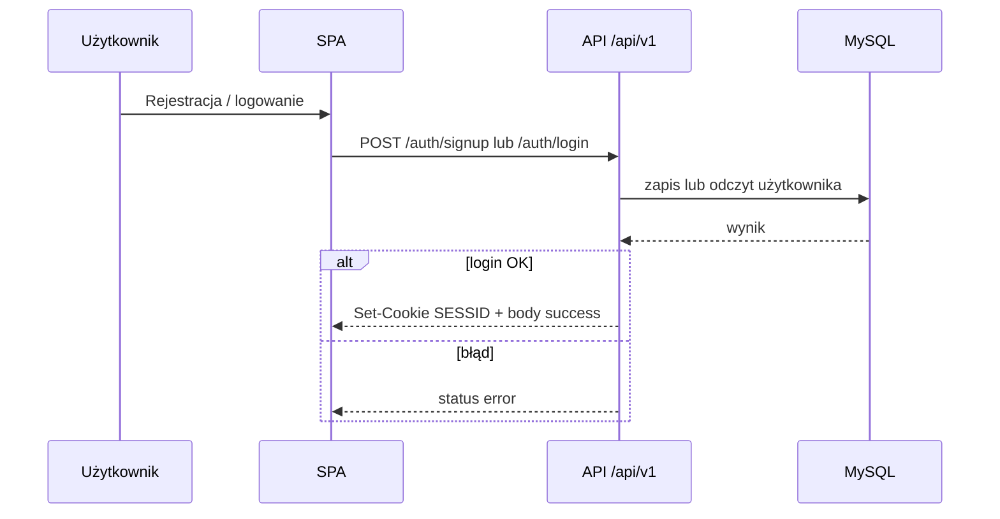
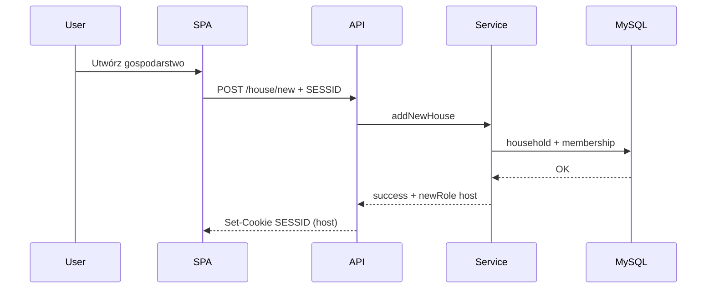
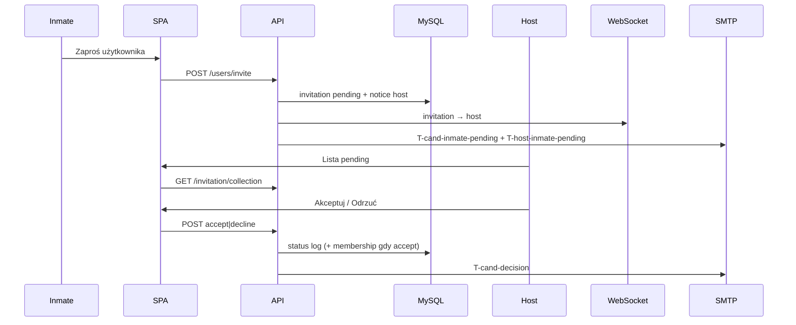
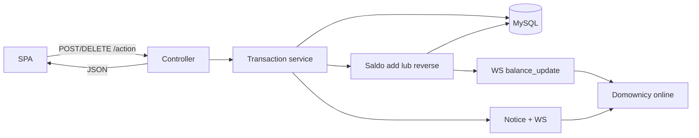
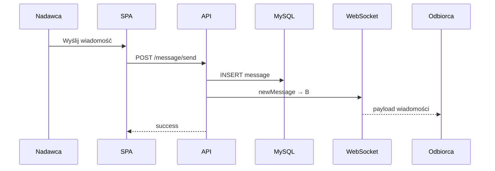
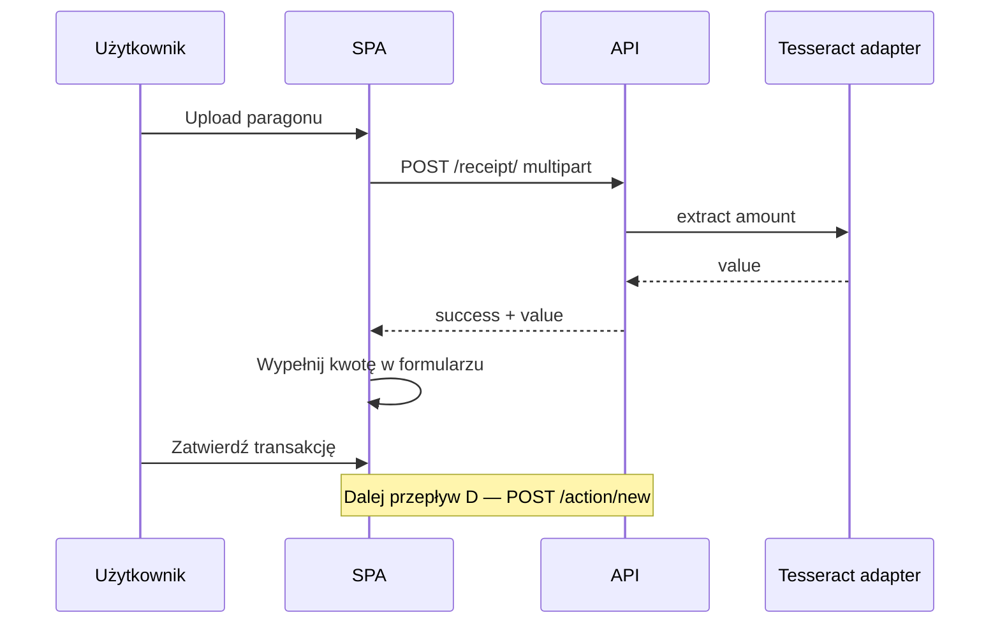

# Przepływy danych — Home Budget Manager

## Cel

Opis **end-to-end** przepływów danych: aktor → HTTP / WebSocket → warstwy backendu → magazyn (MySQL przez **Prisma** w `database/`) → skutki uboczne (saldo, powiadomienia, push). Bez zapytań linia po linii.

Nazewnictwo zgodne ze słownikiem i kontraktem (`/api/v1`, role `user` / `host` / `inmate` / `superadmin`).

---

## A. Rejestracja i logowanie

### Rejestracja

1. Gość wysyła `POST /api/v1/auth/signup` (m.in. nazwa, e-mail, hasło, rola startowa zwykle `user`).
2. API waliduje wejście, sprawdza unikalność e-mail, haszuje hasło, zapisuje użytkownika oraz wiersz `householdUsers` z **`houseId = NULL`** (brak domu) przez warstwę `database/` → Prisma.
3. Odpowiedź sukcesu / błędu w envelope `status` + `message`.

### Logowanie

1. Użytkownik wysyła `POST /api/v1/auth/login` (e-mail, hasło).
2. API weryfikuje dane, wystawia JWT w cookie `SESSID`.
3. SPA używa sesji przy kolejnych żądaniach (`credentials`) i przy handshake WebSocket.

---

## B. Utworzenie gospodarstwa (`user` → `host`)

Warunek: zalogowany użytkownik w roli `user` (bez gospodarstwa).

1. SPA: `POST /api/v1/house/new` (`houseName`, opcjonalnie `initBudget`) + cookie `SESSID`.
2. Controller → service: utworzenie gospodarstwa, powiązanie użytkownika jako hosta, budżet początkowy / saldo startowe.
3. API odświeża sesję: nowe cookie `SESSID` z rolą `host`.
4. SPA przechodzi do dashboardu rdzenia.

---

## C. Zaproszenie → `inmate`

Dwa tryby (norma 2026-11-24):

### C1. Host dodaje od razu

1. Host: `POST /api/v1/users/invite`.
2. API od razu tworzy membership z rolą `inmate` (bez pending).
3. Skutki: notice / WS wg kontraktu + e-mail do kandydata (**T-cand-host-added**).

### C2. Inmate inicjuje → host decyduje

1. Inmate: `POST /api/v1/users/invite` → rekord invitation **pending** (bez membership).
2. Push WS `invitation` do hosta **oraz** trwały wpis notice dla hosta.
3. E-mail: **T-cand-inmate-pending** (kandydat) + **T-host-inmate-pending** (host).
4. Host: `GET /api/v1/invitation/collection` — tylko **pending** (historia statusów zostaje w DB jako log, bez wymogu UI historii).
5. Host: `POST /api/v1/invitation/accept` → membership `inmate` **albo** `POST .../decline` → bez membership; status na rekordzie = log.
6. E-mail do kandydata: **T-cand-decision** (accept lub decline).
7. Awaria SMTP ≠ rollback (K-13).

---

## D. Dodanie / usunięcie transakcji

Warunek dodania: `host` lub `inmate`. Kwota: walidacja max **2** miejsca po przecinku.

### Dodanie

1. SPA: `POST /api/v1/action/new` (`type`, `value`, `catId`).
2. Service zapisuje transakcję w DB.
3. Aktualizacja salda: `income` ↑, `expense` ↓ (`currentBalance`).
4. Notice + WS `notification`; WS `balance_update`.
5. HTTP success do inicjatora.

### Usunięcie

1. SPA: `DELETE /api/v1/action/` (`transactionId`).
2. Authz: **inmate** — tylko własne; **host** — dowolna tx w domu. Brak uprawnień → **403**; brak tx / zły dom → **404**.
3. Korekta salda = **reverse** oryginalnego `type` (delete expense ↑ saldo; delete income ↓).
4. Notice `notifications.deletedAction` (bez osobnej semantyki „host skasował cudzą”) + `balance_update`.

**Sync 2026-11-24:** reguły salda, authz delete i dwa tryby invite.

---

## E. Wiadomość czatu

1. Nadawca: `POST /api/v1/message/send` (m.in. odbiorca, treść) + `SESSID`.
2. Service zapisuje wiadomość w DB.
3. `broadcastMessage` do odbiorcy: zdarzenie `newMessage` z payloadem (id, nadawca, treść, data, status przeczytania).
4. Odbiorca online: UI aktualizuje listę z WS; offline: treść dostępna przy późniejszym pobraniu / odświeżeniu przez HTTP.
5. Oznaczenie przeczytania: `PUT /api/v1/message/readed`; usunięcie: `DELETE /api/v1/message/delete`.

---

## F. OCR paragonu → kwota → formularz transakcji

1. Użytkownik w UI transakcji wybiera plik paragonu.
2. SPA: `POST /api/v1/receipt/` (multipart, pole `receipt`).
3. Backend (multer + Tesseract) zwraca `status: success` oraz `value` (rozpoznana kwota) albo błąd rozpoznania.
4. SPA wstawia `value` do pola kwoty formularza transakcji.
5. Użytkownik uzupełnia typ / kategorię i zatwierdza → dalej przepływ **D** (`POST /api/v1/action/new`).

OCR nie zapisuje transakcji samodzielnie — tylko dostarcza kwotę do UI.

---

## G. Zadania cykliczne (wewnętrzne)

Uruchamiane w procesie API (`node-cron`), bez kontraktu zewnętrznego dla klienta:

- **Zapis dziennych transakcji** — agregacja / snapshot aktywności transakcyjnej na potrzeby historii i zestawień.
- **Zapis dziennego budżetu** — utrwalenie stanu budżetowego w ujęciu dziennym.
- **Bilansowanie transakcji gospodarstwa** — okresowe uzgodnienie / bilans; może skutkować powiadomieniem domowników (`notification`).

Przepływ wspólny (lista):

1. Scheduler odpala task w procesie backendu.
2. Task woła **service**, a service warstwę `database/` (Prisma) — bez raw SQL z taska.
3. W razie potrzeby wywołuje ten sam mechanizm powiadomień co HTTP (zapis notice + WS do domu).
4. Brak odpowiedzi do SPA — efekt widoczny przy kolejnym odczycie HTTP lub na pushu.

---

## Przepływy poza tym dokumentem

- Pełna lista pól request/response — [dokumentacja_komunikacji.md](./dokumentacja_komunikacji.md)
- Drzewo katalogów warstw — [architektura_katalogi_pliki.md](./architektura_katalogi_pliki.md)
- Strategia testowania tych ścieżek — [testy.md](./testy.md)
- Encje / relacje — [model_danych.md](./model_danych.md)
