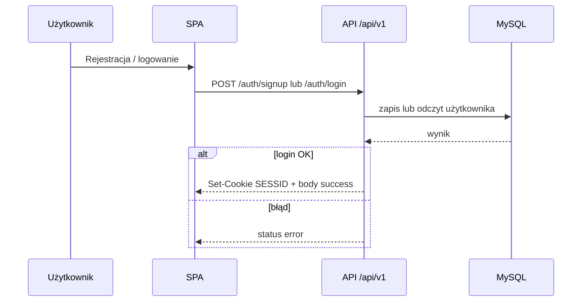
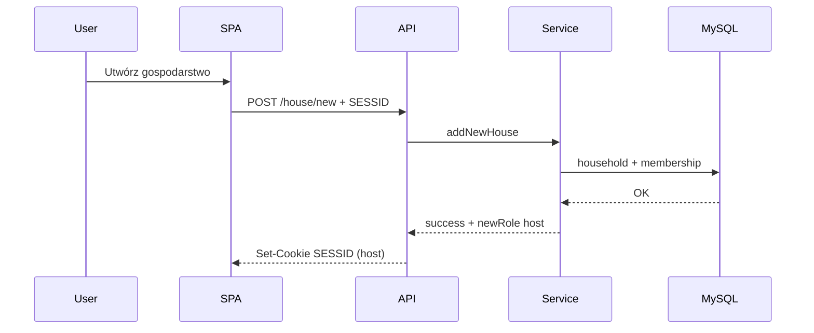
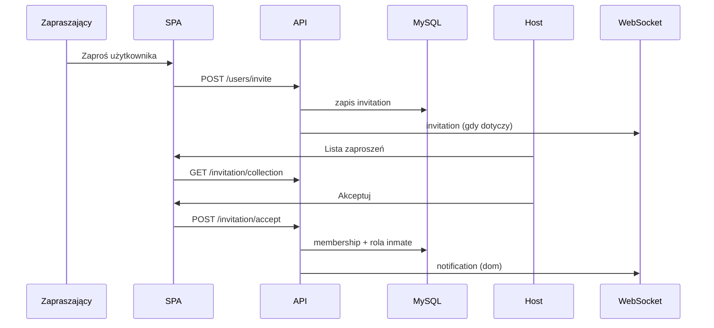
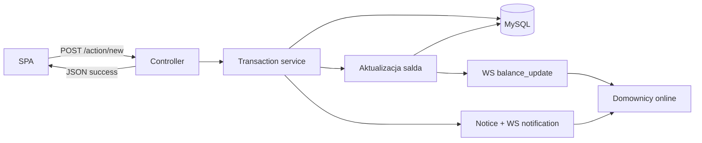
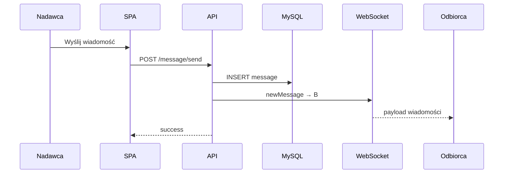
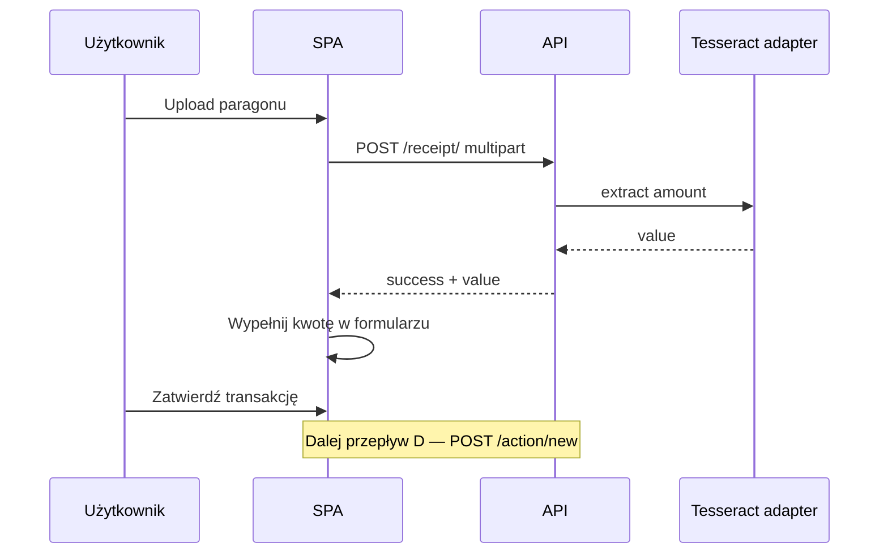

# Przepływy danych — Home Budget Manager

## Cel

Opis **end-to-end** przepływów danych: aktor → HTTP / WebSocket → warstwy backendu → magazyn (MySQL przez **Prisma** w `database/`) → skutki uboczne (saldo, powiadomienia, push). Bez zapytań linia po linii.

Nazewnictwo zgodne ze słownikiem i kontraktem (`/api/v1`, role `user` / `host` / `inmate` / `superadmin`).

---

## A. Rejestracja i logowanie

### Rejestracja

1. Gość wysyła `POST /api/v1/auth/signup` (m.in. nazwa, e-mail, hasło, rola startowa zwykle `user`).
2. API waliduje wejście, sprawdza unikalność e-mail, haszuje hasło, zapisuje użytkownika w DB.
3. Odpowiedź sukcesu / błędu w envelope `status` + `message`.

### Logowanie

1. Użytkownik wysyła `POST /api/v1/auth/login` (e-mail, hasło).
2. API weryfikuje dane, wystawia JWT w cookie `SESSID`.
3. SPA używa sesji przy kolejnych żądaniach (`credentials`) i przy handshake WebSocket.

---

## B. Utworzenie gospodarstwa (`user` → `host`)

Warunek: zalogowany użytkownik w roli `user` (bez gospodarstwa).

1. SPA: `POST /api/v1/house/new` (`houseName`, opcjonalnie `initBudget`) + cookie `SESSID`.
2. Controller → service: utworzenie gospodarstwa, powiązanie użytkownika jako hosta, budżet początkowy / saldo startowe.
3. API odświeża sesję: nowe cookie `SESSID` z rolą `host`.
4. SPA przechodzi do dashboardu rdzenia.

---

## C. Zaproszenie → akceptacja → `inmate`

Typowy przebieg:

1. Członek domu (`host` lub `inmate`) inicjuje zaproszenie: `POST /api/v1/users/invite`.
2. Zapis zaproszenia w DB; możliwy push WebSocket `invitation` do hosta (gdy flow tego wymaga).
3. Host przegląda listę: `GET /api/v1/invitation/collection`.
4. Host akceptuje: `POST /api/v1/invitation/accept` **albo** odrzuca: `POST /api/v1/invitation/decline`.
5. Przy akceptacji: użytkownik dołączany do gospodarstwa z rolą `inmate`; powiadomienie + ewentualny broadcast `notification`.
6. Dołączony użytkownik działa dalej z sesją w roli `inmate` (odświeżenie tokenu / ponowne wejście wg mechanizmu aplikacji).

Kierunek e-mail wychodzący (zaproszenie na skrzynkę) jest powierzchnią planowaną — ten przepływ opiera się na HTTP + WS + notice.

---

## D. Dodanie transakcji

Warunek: `host` lub `inmate`.

1. SPA: `POST /api/v1/action/new` (`type`, `value`, `catId`).
2. Service zapisuje transakcję w DB.
3. Aktualizacja salda gospodarstwa.
4. Zapis powiadomienia + broadcast WebSocket `notification` do domu.
5. Broadcast `balance_update` z nowym saldem do członków domu.
6. Odpowiedź HTTP sukcesu do inicjatora; pozostali domownicy dostają skutki przez WS / odświeżenie list.

---

## E. Wiadomość czatu

1. Nadawca: `POST /api/v1/message/send` (m.in. odbiorca, treść) + `SESSID`.
2. Service zapisuje wiadomość w DB.
3. `broadcastMessage` do odbiorcy: zdarzenie `newMessage` z payloadem (id, nadawca, treść, data, status przeczytania).
4. Odbiorca online: UI aktualizuje listę z WS; offline: treść dostępna przy późniejszym pobraniu / odświeżeniu przez HTTP.
5. Oznaczenie przeczytania: `PUT /api/v1/message/readed`; usunięcie: `DELETE /api/v1/message/delete`.

---

## F. OCR paragonu → kwota → formularz transakcji

1. Użytkownik w UI transakcji wybiera plik paragonu.
2. SPA: `POST /api/v1/receipt/` (multipart, pole `receipt`).
3. Backend (multer + Tesseract) zwraca `status: success` oraz `value` (rozpoznana kwota) albo błąd rozpoznania.
4. SPA wstawia `value` do pola kwoty formularza transakcji.
5. Użytkownik uzupełnia typ / kategorię i zatwierdza → dalej przepływ **D** (`POST /api/v1/action/new`).

OCR nie zapisuje transakcji samodzielnie — tylko dostarcza kwotę do UI.

---

## G. Zadania cykliczne (wewnętrzne)

Uruchamiane w procesie API (`node-cron`), bez kontraktu zewnętrznego dla klienta:

- **Zapis dziennych transakcji** — agregacja / snapshot aktywności transakcyjnej na potrzeby historii i zestawień.
- **Zapis dziennego budżetu** — utrwalenie stanu budżetowego w ujęciu dziennym.
- **Bilansowanie transakcji gospodarstwa** — okresowe uzgodnienie / bilans; może skutkować powiadomieniem domowników (`notification`).

Przepływ wspólny (lista):

1. Scheduler odpala task w procesie backendu.
2. Task czyta / aktualizuje dane w MySQL.
3. W razie potrzeby wywołuje ten sam mechanizm powiadomień co HTTP (zapis notice + WS do domu).
4. Brak odpowiedzi do SPA — efekt widoczny przy kolejnym odczycie HTTP lub na pushu.

---

## Przepływy poza tym dokumentem

- Pełna lista pól request/response — [dokumentacja_komunikacji.md](./dokumentacja_komunikacji.md)
- Drzewo katalogów warstw — [architektura_katalogi_pliki.md](./architektura_katalogi_pliki.md)
- Strategia testowania tych ścieżek — [testy.md](./testy.md)
- Encje / relacje — [model_danych.md](./model_danych.md)
