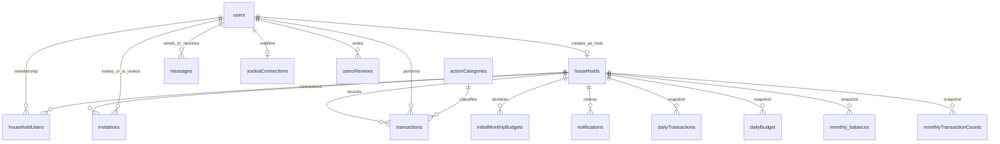

# Model danych — Home Budget Manager

## Cel

Logiczny model MySQL: encje, kluczowe pola, relacje. Bez pełnego dumpa typów kolumna-po-kolumnie.  
**Schemat wykonywalny i migracje:** Prisma (`prisma/schema.prisma` + Prisma Migrate) — norma w [architektura.md](./architektura.md).  
Słownik pojęć: [dictionary.md](./dictionary.md). Przepływy zapisów: [data_flow.md](./data_flow.md).

## Diagram relacji (rdzeń)

## Role w modelu

| Miejsce | Pola | Znaczenie |
|---------|------|-----------|
| `users.role` | `user` \| `host` \| `inmate` \| `superadmin` | Rola globalna konta (sesja JWT) |
| `users.host` / `users.inmate` | flagi / odniesienia pomocnicze | Wskazanie kontekstu gospodarstwa przy awansie do `host` / `inmate` |
| `householdUsers.role` | `host` \| `inmate` | Rola **w składzie** danego domu |

Reguła produktowa: użytkownik w co najwyżej jednym gospodarstwie naraz; `user` = brak aktywnego membershipu budżetowego.

---

## Rdzeń

### `users`

Konto aplikacji.

| Pole (kluczowe) | Opis |
|-----------------|------|
| `id` | PK (UUID) |
| `name` | Nazwa wyświetlana / loginowa |
| `email` | Unikalny identyfikator logowania |
| `password` | Hash bcrypt |
| `role` | Rola globalna |
| `host` / `inmate` | Flagi / powiązania kontekstu domu |
| `avatarName` | Nazwa pliku awatara (opcjonalnie) |
| `acceptCookies` / `completeTour` | Preferencje UI / tour |

### `households`

Gospodarstwo.

| Pole (kluczowe) | Opis |
|-----------------|------|
| `houseId` | PK |
| `userId` | Twórca (host) |
| `userName` | Nazwa hosta (denormalizacja) |
| `houseName` | Nazwa domu |
| `initBudget` | Budżet startowy / bazowy |
| `currentBalance` | Bieżące saldo |
| `createdAt` / `monthlyBalanceDate` | Daty operacyjne / bilansu |

### `householdUsers`

Membership użytkownika w domu.

| Pole (kluczowe) | Opis |
|-----------------|------|
| `userId` | FK → users |
| `houseId` | FK → households (nullable w edge case’ach usuwania) |
| `userName` | Nazwa w kontekście domu |
| `role` | `host` \| `inmate` |

### `invitations`

Zaproszenia do gospodarstwa.

| Pole (kluczowe) | Opis |
|-----------------|------|
| `id` | PK |
| `status` | Stan zaproszenia |
| `invitingUserId` / `invitedUserId` | Strony zaproszenia |
| `houseId` / `hostId` | Dom i host decyzyjny |
| `date` | Czas utworzenia |

### `transactions`

Transakcje (przychód / wydatek).

| Pole (kluczowe) | Opis |
|-----------------|------|
| `id` / `transactionId` | Identyfikatory rekordu |
| `userId` / `houseId` | Kto / w którym domu |
| `catId` | FK → `actionCategories` |
| `type` | `income` \| `expense` |
| `value` | Kwota |
| `addedAt` | Czas dodania |

### `actionCategories`

Kategorie transakcji.

| Pole (kluczowe) | Opis |
|-----------------|------|
| `id` | PK |
| `name` | Nazwa |
| `type` | Typ / klasyfikacja kategorii |

### `initialMonthlyBudgets`

Deklaracje budżetu miesięcznego.

| Pole (kluczowe) | Opis |
|-----------------|------|
| `id` | PK |
| `houseId` | FK → households |
| `value` | Kwota |
| `validUntil` / `addedAt` | Ważność / czas dodania |

### `messages`

Czat wewnętrzny.

| Pole (kluczowe) | Opis |
|-----------------|------|
| `id` | PK |
| `senderId` / `recipientId` | FK → users |
| `content` | Treść |
| `datetime` | Czas |
| `is_read` | Przeczytane |

### `notifications`

Powiadomienia powiązane z domem.

| Pole (kluczowe) | Opis |
|-----------------|------|
| `id` | PK |
| `houseId` | FK → households |
| `category` | Kategoria notice |
| `noticeData` | Payload (JSON / tekst) |

### `socketConnections`

Rejestr aktywnych połączeń Socket.io.

| Pole (kluczowe) | Opis |
|-----------------|------|
| `id` | PK |
| `userId` | FK → users |
| `connectionId` | Id socketu |
| `expireDate` | TTL / wygaśnięcie |

---

## Snapshoty / projekcje (cron)

Nie zastępują tabeli `transactions` — służą zestawieniom i bilansom okresowym.

| Tabela | Rola |
|--------|------|
| `dailyTransactions` | Dzienna liczba / agregat transakcji per dom |
| `dailyBudget` | Dzienny snapshot wartości budżetu / salda |
| `monthly_balances` | Miesięczny bilans domu |
| `monthlyTransactionCounts` | Licznik transakcji w oknie bilansu |

Źródło prawdy operacyjnej na bieżąco: `transactions` + `households.currentBalance`. Snapshoty zasilane taskami z `tasks/`.

---

## Otoczka

### `technologies`

Pozycje stacku na landingu (`id`, `name`, `icon`).

### `usersReviews`

Recenzje (`id`, `rating`, `content`, `userName`, `userId`, `date`).

### Galeria screenshotów

Pliki w storage backendu (`app-images` / multer) — **bez** osobnej tabeli jako źródła prawdy w modelu v1.

---

## Zasady spójności (skrót)

1. Transakcja zawsze w kontekście `houseId` członka domu.  
2. Zmiana salda domu towarzyszy mutacji transakcji (przepływ D).  
3. Usunięcie domu / użytkownika pociąga czyszczenie powiązanych transakcji i membershipu (logika w services).  
4. Powiadomienia i WS opierają się na `houseId` / `userId` z tych tabel — nie na zaufaniu do klienta.

## Schemat i migracje (Prisma)

| Norma | Opis |
|-------|------|
| Źródło prawdy schematu | `backend/prisma/schema.prisma` — modele odpowiadają encjom poniżej (mapowanie nazw tabel/pól w schema) |
| Zmiana modelu | Najpierw aktualizacja `schema.prisma`, potem **obowiązkowa** migracja Prisma Migrate w `prisma/migrations/` |
| Dostęp runtime | Wyłącznie Prisma Client przez warstwę `database/` — bez raw SQL |
| Ręczne DDL | Zabronione jako proces utrzymania schematu (phpMyAdmin tylko diagnostyka / awaryjne odczyty — nie jako pipeline zmian) |

Stan as-is może jeszcze nie mieć katalogu `prisma/` — wprowadzenie ORM + migracji to refaktor **R6**.

## Seed (dev / test)

| Norma | Opis |
|-------|------|
| Cel | Powtarzalne dane startowe pod **local/dev** oraz **środowisko testowe** (nie produkcja) |
| Narzędzie | Seed Prisma (skrypt seed powiązany z projektem Prisma) — spójny ze `schema.prisma` |
| Zakres | Minimalny zestaw umożliwiający ścieżki krytyczne (m.in. użytkownik, kategorie gdy wymagane przez transakcje); bez sekretów produkcyjnych |
| Prod | Seed **nie** jest częścią deployu produkcyjnego |

Szczegóły uruchamiania w testach: [testy.md](./testy.md).

## Prisma Studio

**Prisma Studio** — dozwolone narzędzie operatorskie/deweloperskie do podglądu i ręcznej inspekcji danych na bazach **non-prod**. Nie zastępuje migracji, seeda ani warstwy `database/` w aplikacji. Na produkcji — tylko świadomie i ostrożnie (jak inne klienty SQL); nie jest powierzchnią produktu.

## Poza tym dokumentem

- Pełna lista indeksów i mikro-optymalizacja typów w schema (doprecyzowanie przy R6).  
- Optymalizacja zapytań dashboardu / osobne read-modele.
